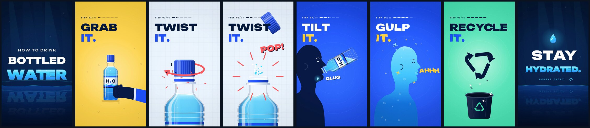

# How to Drink Bottled Water

A 26-second, 9:16 (1080×1920, 60 fps) motion graphic. It's built for phone screens and loops seamlessly.

**▶ Watch:** [`video/how-to-drink-bottled-water.mp4`](video/how-to-drink-bottled-water.mp4)
· SFX-only cut (no music, for adding your own track): [`video/how-to-drink-bottled-water_sfx-only.mp4`](video/how-to-drink-bottled-water_sfx-only.mp4)



Five steps with a repeating hook: **GRAB IT. TWIST IT. TILT IT. GULP IT. RECYCLE IT.** It ends on **STAY HYDRATED.**
One hero bottle carries through most of the film. Scene changes happen around it through transitions, without hard cuts.
The edit sits on a 120 BPM grid, so every hit (landing, cap clicks, pop, glugs, bin) lands on the beat.

| Time | Scene | Transition out |
|---|---|---|
| 0.0–2.5 | **Intro**: a drop falls into still water and the title rises out of the splash. "WATER" fills with liquid and is reflected in the surface. | **Liquid wipe**: the water level rises over the title, then aqua and yellow waves wash through as the beat drops |
| 3.0–6.4 | **01 GRAB IT**: the bottle drops in with squash and stretch, the label spins on a real cylinder, and the water sloshes on impact. A hand grips it and lifts it. | **Push-in + iris**: zoom-blurred dive into the cap while the new background opens from the cap's silhouette |
| 7.0–10.0 | **02 TWIST IT**: cap close-up. The grip ridges really rotate over three clicks, the seal cracks, and the cap pops with a spray. | **Clock wipe**: the wipe edge is pinned to the bottle's axis and sweeps as the bottle tilts |
| 10.5–13.5 | **03 TILT IT**: bottle to the lips. The water stays level and volume-true as it drains. GLUG bubbles rise inside, and the throat gulps. | **The dive**: the camera follows x-ray gulps down the throat |
| 14.0–18.0 | **04 GULP IT**: the body fills like a gauge from 0 to 100%. Eyes go happy: **AHHH**. | **Bubble burst**: rising bubbles reveal the next scene |
| 18.5–21.4 | **05 RECYCLE IT**: the cap screws back on, the bottle crushes, flips into the bin, and a recycle symbol rises out of it. | **Zoom-through**: a water drop is born in the symbol's centre as the camera flies through |
| 22.0–26.0 | **STAY HYDRATED.** The drop rises, the letters fill, then sink back into the water. | **Loops** back to frame 1 |

## How it's made

Everything is code. Each frame is a pure function of time `t`, drawn on an HTML canvas. That means any frame can be rendered on demand: scrubbing, parallel rendering and exact sound sync all come from that.

- `src/timeline.js`: the timing sheet, shared by the picture and the soundtrack
- `src/core.js`: easing (incl. cubic-bezier), keyframe tracks, springs, colour, seeded RNG, kinetic type
- `src/bottle.js`: the bottle. It has a profile-built PET outline, a cylinder-mapped label and rotating cap ridges. The water surface is solved each frame so its area stays constant at any tilt or squash, and a damped-pendulum slosh is driven by the bottle's real acceleration.
- `src/characters.js`: silhouette hand and drinker (with throat gulp and head tilt)
- `src/fx.js`: splash crown + Worthington jet, ripples, bubbles, waves, arrows, recycle symbol, bin
- `src/scenes.js`: the seven shots, six transitions, camera, and the "\_\_\_ IT." header with its odometer step counter
- `src/post.js`: WebGL finishing pass (shockwave ripples, underwater wobble, zoom blur, chroma). Vignette and grain are done in 2D.
- `render/audio.mjs`: a dependency-free synth. It makes the 120 BPM IV–V–iii–vi groove (kick, clap, hats, bass, plucks, marimba, pads, reverb, ping-pong delay, sidechain) plus about 30 synced sound effects, mastered to −14 LUFS.
- `render/render.mjs`: parallel headless-Chromium renderer, then ffmpeg (H.264 High, BT.709, faststart)

## Preview in the browser

```bash
node render/serve.mjs        # then open http://localhost:8080
```

Controls: **Space** play/pause, **← →** step one frame, scrubber, sound toggle. Add `?t=11.5&paused` to the URL to jump to a moment.

## Render the video yourself

Requirements: Node 18+, ffmpeg with libx264, and Chromium for Playwright.

```bash
npm install && npx playwright install chromium
npm run build      # soundtrack (out/*.wav, media/soundtrack.m4a) + MP4 in video/
```

Useful flags: `node render/render.mjs --from 6 --to 8` (render a slice), `--fps 30`, `--crf 20`, `--workers 4`.
To review individual moments, use `node render/stills.mjs out/stills 0.9 6.8 11.6` (PNG per time plus a contact sheet).

Fonts: Unbounded, Inter and JetBrains Mono, all under the SIL Open Font License (see `fonts/`).
